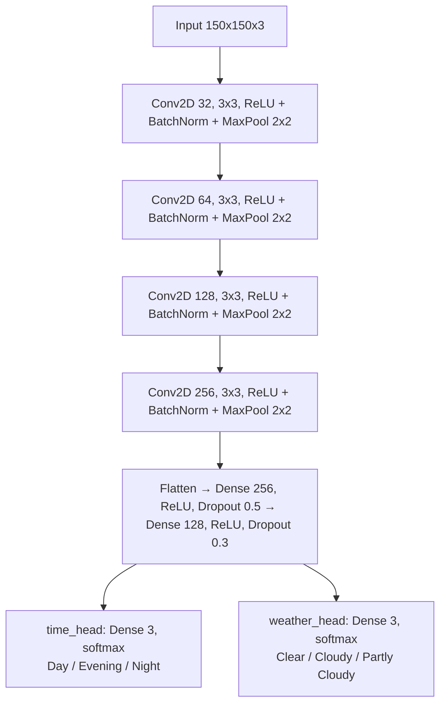
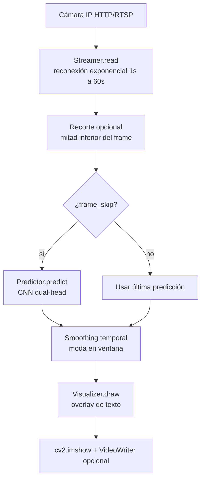

# ml-climate-dentifier

Clasificador de clima y momento del día desde una cámara IP en tiempo real. Clasifica el momento del día (Day/Evening/Night) y el clima (Clear/Cloudy/Partly Cloudy) usando una CNN de doble cabeza con TensorFlow/Keras.

[](https://python.org)
[](https://tensorflow.org)
[](https://opencv.org)
[](LICENSE)

## Contenido

- [Características](#características)
- [Arquitectura](#arquitectura)
- [Stack](#stack)
- [Estructura del repositorio](#estructura-del-repositorio)
- [Instalación](#instalación)
- [Uso](#uso)
- [Configuración](#configuración)
- [Tests / CI](#tests--ci)
- [Dataset](#dataset)
- [Modelos](#modelos)
- [Rendimiento esperado](#rendimiento-esperado)
- [Roadmap](#roadmap)
- [Licencia](#licencia)

## Características

- Clasificación en tiempo real de **dos atributos independientes** de la escena:

| Atributo | Clases |
|----------|--------|
| **Momento del día** (`Time of Day`) | Day, Evening, Night |
| **Clima** (`Weather`) | Clear, Cloudy, Partly Cloudy |

- Arquitectura **dual-head** (v2): dos softmax independientes, una por atributo.
- **Sample-weight masking** para entrenar con etiquetas parciales (imágenes con solo label de tiempo o de clima).
- Backbone alternativo **MobileNetV2** (transfer learning) para datasets pequeños.
- Pipeline de inferencia con frame skipping, smoothing temporal por moda y reconexión automática con exponential backoff.
- Overlay OpenCV con porcentajes de confianza, grabación opcional de video y recorte configurable del frame (mitad inferior).
- Dataset de ~1,430 imágenes etiquetadas manualmente (Jul–Sep 2024).
- Scripts de captura periódica (ffmpeg) y etiquetado por timestamp.
- Docker listo para deploy y suite de tests pytest.

## Arquitectura

### El problema en v1 (solucionado)

La versión 1 entrenaba un modelo con **una sola softmax de 6 clases** donde `Day`, `Evening`, `Night`, `Clear`, `Cloudy` y `Partly Cloudy` **competían entre sí**. Esto no tiene sentido semántico: el momento del día y el clima son atributos independientes. Una imagen puede ser "Day" y "Clear" simultáneamente.

### Solución: Dual-Head Architecture (v2)



El modelo tiene **dos cabezas de salida independientes**, cada una con su propia softmax. **Pérdida combinada**:

```
Loss = categorical_crossentropy(time_labels, time_pred)
     + categorical_crossentropy(weather_labels, weather_pred)
```

### Sample-Weight Masking

Para entrenar con datos parcialmente etiquetados se usa **sample-weight masking**:

- Imágenes de `dataset/day/`: `weight_time=1.0`, `weight_weather=0.0` → solo contribuyen a la pérdida de tiempo.
- Imágenes de `dataset/clear/`: `weight_time=0.0`, `weight_weather=1.0` → solo contribuyen a la pérdida de clima.

Esto permite usar **todas las imágenes disponibles** sin necesidad de tener ambas etiquetas.

### Pipeline de inferencia en vivo



### Backbone alternativo: MobileNetV2

```bash
python -m training.train --backbone mobilenetv2
```

Usa MobileNetV2 pre-entrenado en ImageNet como feature extractor (convolutional base congelada), ideal cuando el dataset es pequeño.

## Stack

| Paquete | Versión | Propósito |
|---------|---------|-----------|
| `tensorflow` | 2.x (>=2.20) | Entrenamiento e inferencia del modelo |
| `opencv-python` | 4.x | Captura de video, procesamiento, visualización |
| `numpy` | 2.x | Operaciones numéricas |
| `matplotlib` | 3.x | Gráficas de entrenamiento |
| `scikit-learn` | 1.x | Métricas de evaluación (confusion matrix, classification report) |
| `seaborn` | 0.13+ | Visualización de matrices de confusión |
| `Pillow` | 11.1 | Procesamiento de imágenes |
| `python-dotenv` | 1.x | Carga de variables de entorno |
| `pyyaml` | 6.x | Parseo de `config.yaml` |

## Estructura del repositorio

```
ml-climate-dentifier/
├── app.py                      # Entry point: clasificación en tiempo real
├── config.yaml                 # Configuración centralizada (YAML)
├── constants.py
├── common/                     # Helpers compartidos (training + inference + scripts)
│   ├── __init__.py
│   ├── config.py               # Carga YAML + overrides de .env
│   └── data.py                 # Labels, iteración de imágenes, preprocesado
├── requirements.txt            # Dependencias Python
├── pyproject.toml              # Metadata del proyecto + pytest/ruff/mypy/vulture config
├── Dockerfile                  # Imagen Docker lista para deploy (python:3.10-slim)
├── Makefile                    # Comandos comunes (run, train, test, docker)
├── inference/                  # Paquete de inferencia en vivo
│   ├── __init__.py
│   ├── config.py               # Re-exporta common.config
│   ├── predictor.py            # Carga del modelo, predict, smoothing temporal
│   ├── streamer.py             # Captura de cámara con reconexión exponencial
│   └── visualizer.py           # Overlay OpenCV, display, grabación
├── training/                   # Paquete de entrenamiento
│   ├── __init__.py
│   ├── model.py                # Arquitectura CNN / MobileNetV2 dual-head
│   ├── dataset.py              # DualDataGenerator con sample-weight masking
│   ├── train.py                # Loop de entrenamiento con callbacks
│   └── evaluate.py             # Matrices de confusión, classification reports
├── scripts/                    # Utilidades
│   ├── build_dataset.py        # Combina directorios time+weather en 9 clases
│   ├── label_captures.py       # Etiqueta captures/ por timestamp
│   └── capture.sh              # Captura periódica de frames via ffmpeg
├── tests/                      # Suite de tests (pytest)
│   ├── __init__.py
│   ├── conftest.py             # sys.path para importar scripts/
│   ├── test_common.py          # Tests de common/ (labels, imágenes, config)
│   ├── test_config.py          # Tests del cargador de configuración
│   ├── test_dataset.py         # Tests del DualDataGenerator
│   ├── test_model.py           # Tests de la arquitectura (shapes, outputs)
│   ├── test_predictor.py       # Tests del predictor y smoothing
│   └── test_scripts.py         # Tests de scripts (build_dataset, label_captures)
├── models/                     # Modelos .h5 entrenados (gitignored)
├── dataset/                    # Dataset RAW (gitignored)
├── captures/                   # Capturas periódicas (gitignored)
├── .env.example                # Template de variables de entorno
├── .gitignore
└── README.md
```

## Instalación

### Requisitos

- Python 3.9+.
- pip.
- OpenCV (vía pip, pero necesita `libgl1` en Linux).
- Opcional: GPU con CUDA para entrenar más rápido.

### Pasos

```bash
# 1. Clonar
git clone https://github.com/bi0punk/ml-climate-dentifier
cd ml-climate-dentifier

# 2. (Recomendado) Crear virtualenv
python -m venv .venv
source .venv/bin/activate   # Linux/Mac
# .venv\Scripts\activate    # Windows

# 3. Instalar dependencias
pip install -r requirements.txt

# 4. Configurar entorno
cp .env.example .env
# Editar .env con URL de tu cámara y ruta del modelo

# 5. Verificar instalación
python -c "import cv2, tensorflow, numpy; print('OK')"
```

## Uso

### Inferencia en vivo

```bash
# Usando config.yaml por defecto
python app.py

# Con grabación de video activada
python app.py --record

# Con archivo de configuración personalizado
python app.py --config mi_config.yaml
```

Controles: tecla `q` para salir.

**Frame Skip**: con `frame_skip=5`, si la cámara entrega 30fps, solo se predice ~6fps, reduciendo el uso de CPU/GPU 5x.

**Smoothing Temporal**: filtro de **moda** sobre una ventana deslizante de las últimas N predicciones, estabilizando el resultado.

**Reconexión Automática**: si el stream se cae, el `Streamer` intenta reconectar con exponential backoff: 1s → 2s → 4s → 8s ... hasta 60s máximo.

### Model Type: single_6class vs dual_head

| Tipo | Descripción | Cuándo usarlo |
|------|-------------|---------------|
| `single_6class` | Una softmax de 6 salidas, `app.py` divide `[:3]` (time) y `[3:]` (weather) | Modelos v1 |
| `dual_head` | Dos softmax independientes de 3 salidas cada una | Modelos v2 (entrenados con `training.train` nuevo) |

### Entrenamiento

```bash
# Entrenamiento básico (CNN propia)
python -m training.train

# Especificar número de épocas y batch size
python -m training.train --epochs 50 --batch-size 64

# Transfer Learning con MobileNetV2
python -m training.train --backbone mobilenetv2

# Entrenar y evaluar al finalizar
python -m training.train --evaluate

# Dataset en otra ruta
python -m training.train --data-dir data/processed

# Guardar modelos en otra carpeta
python -m training.train --model-dir mi_carpeta
```

Parámetros:

| Flag | Default | Descripción |
|------|---------|-------------|
| `--data-dir` | `dataset` | Ruta al dataset raw |
| `--model-dir` | `models` | Carpeta para guardar modelos |
| `--backbone` | `cnn` | Arquitectura: `cnn` o `mobilenetv2` |
| `--batch-size` | `32` | Tamaño de lote |
| `--epochs` | `30` | Épocas máximas (early stopping puede parar antes) |
| `--learning-rate` | `0.001` | Tasa de aprendizaje inicial |
| `--patience` | `7` | Épocas sin mejora para early stopping |
| `--evaluate` | `false` | Ejecutar evaluación al finalizar |

Callbacks incluidos:

| Callback | Monitorea | Comportamiento |
|----------|-----------|----------------|
| **EarlyStopping** | `val_loss` | Detiene el entrenamiento si no mejora tras 7 épocas; restaura los mejores pesos |
| **ModelCheckpoint** | `val_loss` | Guarda el mejor modelo observado durante el entrenamiento |
| **ReduceLROnPlateau** | `val_loss` | Reduce la LR a la mitad si no hay mejora tras 3 épocas, mínimo `1e-6` |
| **CSVLogger** | — | Guarda todas las métricas por época en `training_log_TIMESTAMP.csv` |

Output del entrenamiento:

```
models/
├── best_model_20240710_120000.h5       # Mejor modelo (val_loss mínimo)
├── weather_classifier_20240710_120000.h5  # Modelo final (última época)
├── training_log_20240710_120000.csv      # Métricas por época
├── training_plot_20240710_120000.png     # Gráficas de accuracy/loss
└── config_20240710_120000.json           # Configuración usada
```

Si se usa `--evaluate`, al terminar se ejecuta matriz de confusión para tiempo y clima, classification report por clase, y resultados en consola + gráficos guardados.

### Scripts

**build_dataset.py** — construye un dataset de 9 clases combinadas (`day_clear`, `evening_cloudy`, etc.) a partir de los directorios separados. Útil para entrenar un modelo de 9 clases en vez del dual-head.

```bash
python scripts/build_dataset.py --analyze     # análisis sin modificar archivos
python scripts/build_dataset.py               # construir dataset combinado
python scripts/build_dataset.py --copy        # copiar en vez de symlinks
python scripts/build_dataset.py --raw-dir dataset --output-dir data/processed
```

**label_captures.py** — infiere el momento del día para las imágenes de `captures/` según el timestamp del nombre del archivo:

- 06:00–18:00 → `day/`
- 18:00–21:00 → `evening/`
- 21:00–06:00 → `night/`

```bash
python scripts/label_captures.py
```

**capture.sh** — captura frames periódicamente de la cámara IP usando ffmpeg.

```bash
./scripts/capture.sh          # cada 3 minutos (default)
./scripts/capture.sh 600      # cada 10 minutos
RTSP_URL="rtsp://..." ./scripts/capture.sh
```

### Docker

```bash
make docker-build
# o manual:
docker build -t ml-climate-dentifier .
```

```bash
make docker-run
# o manual (con cámara USB local):
docker run --rm \
  --device=/dev/video0:/dev/video0 \
  -e IP_CAMERA_URL="rtsp://..." \
  ml-climate-dentifier
```

La imagen usa `python:3.10-slim` e incluye OpenCV con soporte ffmpeg.

## Configuración

### config.yaml (referencia)

| Ruta | Campo | Tipo | Default | Descripción |
|------|-------|------|---------|-------------|
| `camera.url` | string | `"${RTSP_URL}"` | URL del stream (HTTP, RTSP, MJPEG) |
| `camera.width` | int | `640` | Ancho de captura |
| `camera.height` | int | `480` | Alto de captura |
| `camera.fps` | int | `30` | FPS objetivo de captura |
| `camera.buffer_size` | int | `10` | Tamaño del buffer OpenCV |
| `camera.transport` | string | `"tcp"` | Transporte RTSP (`udp` o `tcp`) |
| `camera.reconnect_delay` | float | `1.0` | Espera inicial antes de reconectar (s) |
| `camera.max_reconnect_delay` | float | `60.0` | Espera máxima tras fallos repetidos (s) |
| `crop.enabled` | bool | `true` | Recortar el frame |
| `crop.region` | string | `"bottom_half"` | `bottom_half`: solo la mitad inferior (cámara dual-lens) |
| `model.path` | string | `"models/weather_classifier_*.h5"` | Ruta al archivo `.h5` |
| `model.input_size` | int | `150` | Tamaño esperado por el modelo (px) |
| `model.type` | string | `"dual_head"` | Formato: `single_6class` o `dual_head` |
| `inference.frame_skip` | int | `5` | Predecir cada N frames |
| `inference.smoothing_window` | int | `5` | Ventana para filtro de moda |
| `inference.confidence_threshold` | float | `0.0` | Confianza mínima para mostrar |
| `display.width` | int | `640` | Ancho de ventana de visualización |
| `display.height` | int | `480` | Alto de ventana de visualización |
| `display.font_scale` | float | `1.5` | Tamaño de fuente del overlay |
| `display.font_thickness` | int | `3` | Grosor de fuente |
| `display.color_time` | list | `[0, 255, 0]` | Color BGR del texto de tiempo |
| `display.color_weather` | list | `[0, 255, 0]` | Color BGR del texto de clima |
| `record.enabled` | bool | `false` | Grabar video a archivo |
| `record.output_path` | string | `"output.avi"` | Ruta del video de salida |
| `record.codec` | string | `"XVID"` | Códec de video |
| `record.fps` | float | `20.0` | FPS del video grabado |
| `labels.time` | list | `["Day", "Evening", "Night"]` | Nombres de clases de tiempo |
| `labels.weather` | list | `["Clear", "Cloudy", "Partly Cloudy"]` | Nombres de clases de clima |

### .env (variables de entorno)

| Variable | Descripción | Ejemplo |
|----------|-------------|---------|
| `IP_CAMERA_URL` | URL del stream (sobreescribe config.yaml) | `rtsp://192.168.1.92:554/onvif1` |
| `MODEL_PATH` | Ruta al modelo (sobreescribe config.yaml) | `models/mi_modelo.h5` |
| `RTSP_URL` | URL completa con credenciales | `rtsp://user:pass@ip:554/stream` |
| `RTSP_USER` / `RTSP_PASSWORD` | Credenciales para componer `RTSP_URL` | `admin` / `pass` |

Las variables de entorno **siempre tienen prioridad** sobre `config.yaml`.

## Tests / CI

```bash
# Ejecutar toda la suite
make test

# O directamente con pytest
python -m pytest tests/ -v

# Con cobertura
pip install pytest-cov
python -m pytest tests/ --cov=inference --cov=training
```

## Calidad / QA

```bash
# Lint estático
ruff check .

# Type checking
mypy .

# Seguridad / dead code
bandit -r training inference scripts common app.py
vulture training inference scripts common app.py

# Complejidad
radon cc training inference scripts -s
```

Tests incluidos:

| Archivo | Lo que prueba |
|---------|---------------|
| `test_config.py` | Carga de config.yaml, override de env vars, configs personalizados |
| `test_predictor.py` | Inicialización del predictor, lógica de smoothing |
| `test_dataset.py` | one-hot encoding, carga del dataset, shapes del generador |
| `test_model.py` | Creación de modelo CNN/MobileNetV2, shapes de salida, sumas de softmax |
| `test_common.py` | Helpers compartidos (labels, iteración de imágenes, preprocesado) |
| `test_scripts.py` | build_dataset y label_captures con fixtures |

CI — GitHub Actions (`.github/workflows/ci.yml`) sobre Python 3.11, disparado en push/PR a `main`/`master`:

- `ruff check .`.
- `mypy .`, `bandit` y `vulture`.
- Suite completa de tests (`pytest tests/ -q`).

## Dataset

### Estructura actual (RAW)

| Directorio | Cantidad | Tipo de Label | Desbalance vs Clase Mayoritaria |
|------------|----------|---------------|---------------------------------|
| `day/` | 628 | Time: Day | (mayoría) |
| `evening/` | 132 | Time: Evening | 4.8x menos que Day |
| `night (Nightvision)/` | 585 | Time: Night | 1.1x menos que Day |
| `clear/` | 65 | Weather: Clear | (mayoría weather) |
| `cloudy/` | 10 | Weather: Cloudy | 6.5x menos que Clear |
| `partly_cloudy/` | 10 | Weather: Partly Cloudy | 6.5x menos que Clear |
| **Total** | **1,430** | — | — |

### Cómo se usan las etiquetas parciales

Cada imagen tiene solo **un label conocido** (time O weather, no ambos). El `DualDataGenerator` asigna:

- Para imágenes de `day/`, `evening/`, `night/`: `time_label` one-hot conocido, `weather_label` desconocido, `sample_weight = [1.0, 0.0]`.
- Para imágenes de `clear/`, `cloudy/`, `partly_cloudy/`: `weather_label` one-hot conocido, `time_label` desconocido, `sample_weight = [0.0, 1.0]`.

## Modelos

| Archivo | Fecha | Clases | Tipo | Descripción |
|---------|-------|--------|------|-------------|
| `day_evening_night_classifier_20240728.h5` | 2024-07-28 | 3 (time only) | v1 single_6class | Solo clasifica momento del día |
| `day_evening_night_clear_cloudy_partly_cloudy_classifier_20240729.h5` | 2024-07-29 | 6 (time+weather) | v1 single_6class | Primer intento de clasificación conjunta |
| `day_evening_night_clear_cloudy_partly_cloudy_classifier_20240923.h5` | 2024-09-23 | 6 (time+weather) | v1 single_6class | Modelo v1 mejorado |

Compatibilidad:

| Modelo | `config.yaml model.type` | Funciona con |
|--------|--------------------------|--------------|
| v1 (6 clases, softmax única) | `single_6class` | `app.py` |
| v2 (dual-head, 2 salidas) | `dual_head` | `app.py`, `training/` |

Para usar un modelo v2:

```yaml
model:
  path: "models/weather_classifier_20240710.h5"
  type: "dual_head"
```

## Rendimiento esperado

| Escenario | Backbone | Frame Skip | FPS Aprox | Plataforma |
|-----------|----------|------------|-----------|------------|
| Inferencia CPU | CNN | 5 | ~10-15 fps | Laptop moderna (i7, 16GB) |
| Inferencia CPU | MobileNetV2 | 5 | ~8-12 fps | Laptop moderna (i7, 16GB) |
| Inferencia GPU | CNN | 5 | ~25-30 fps | NVIDIA GTX 1660+ |
| Inferencia GPU | MobileNetV2 | 5 | ~25-30 fps | NVIDIA GTX 1660+ |
| Entrenamiento | CNN | — | ~5 min/30 epochs | NVIDIA GTX 1660 |
| Entrenamiento | MobileNetV2 | — | ~8 min/30 epochs | NVIDIA GTX 1660 |

*Nota: los FPS dependen de la cámara, red y resolución. Los tiempos de entrenamiento dependen del tamaño del dataset.*

## Roadmap

### Corto plazo

- [ ] Balancear el dataset (más imágenes evening, cloudy, partly_cloudy).
- [ ] Entrenar y publicar modelo v2 con métricas de evaluación.
- [ ] Agregar detección de lluvia (rain class).
- [ ] Dashboard web con Flask/FastAPI para mostrar histórico.

### Mediano plazo

- [ ] Interfaz web con gráficas de tendencias (evolución del clima en el tiempo).
- [ ] Almacenamiento de clasificaciones en SQLite/PostgreSQL.
- [ ] Soporte para múltiples cámaras simultáneas.
- [ ] Sistema de alertas (cambio brusco de clima, detección de eventos).

### Largo plazo

- [ ] Despliegue en edge devices (Raspberry Pi, Jetson Nano).
- [ ] Modelo de segmentación semántica para análisis más granular.
- [ ] Integración con home automation (Home Assistant, OpenHAB).
- [ ] Aplicación móvil para monitoreo remoto.

## Licencia

MIT — ver [LICENSE](LICENSE).